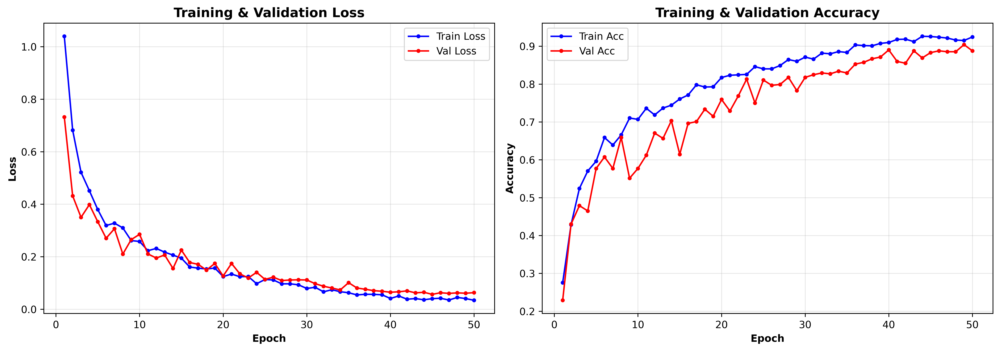
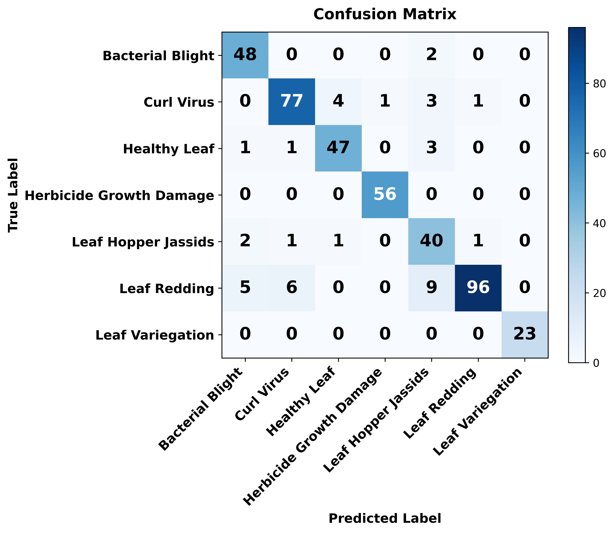
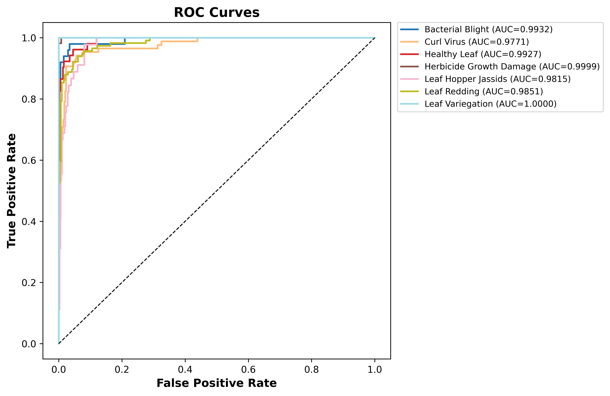
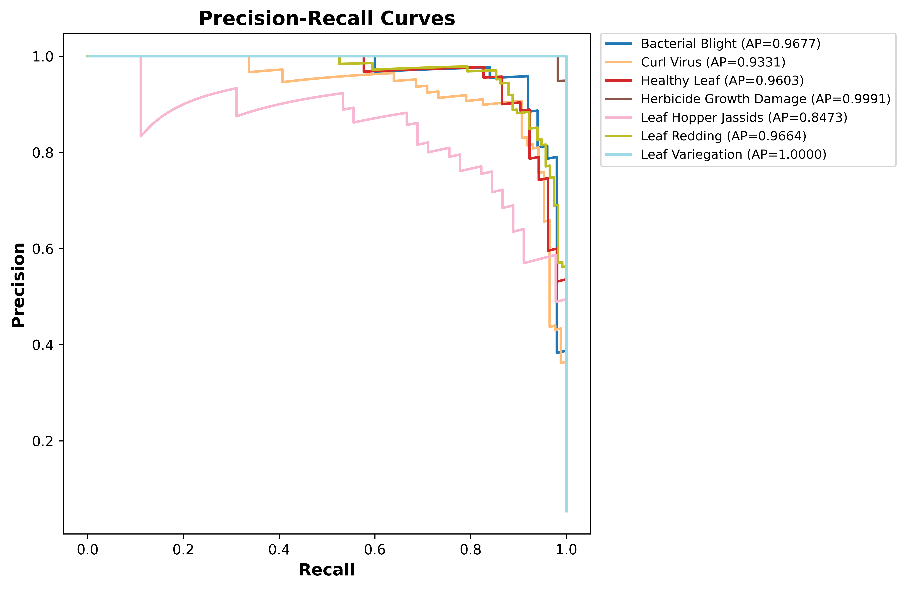
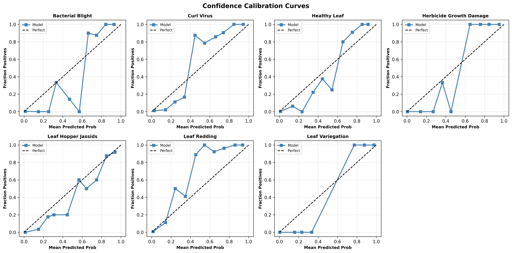
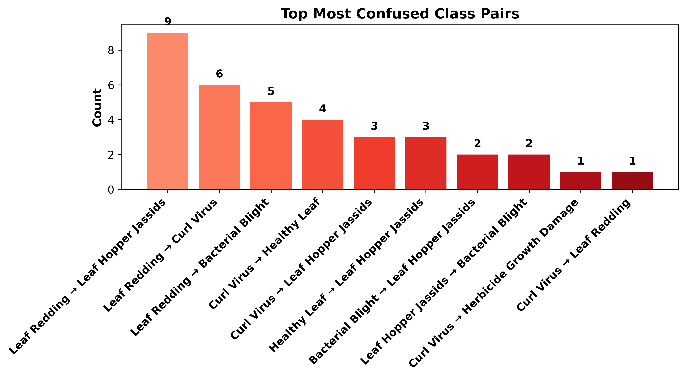
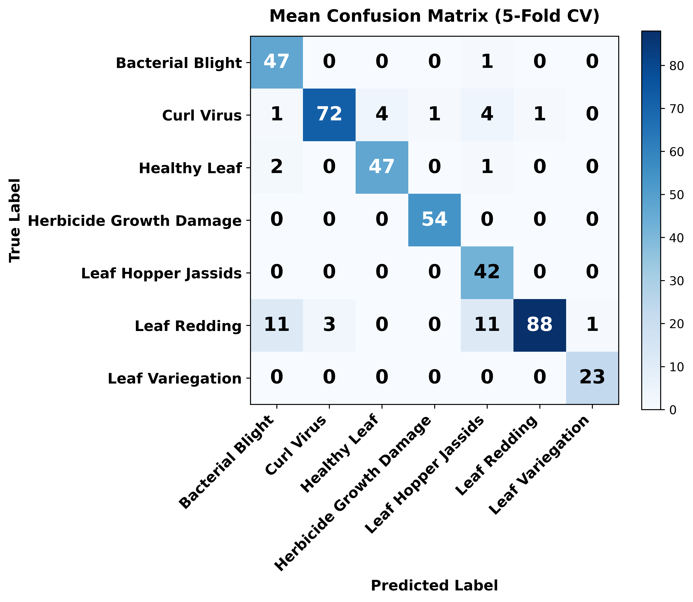

# A Lightweight Dual-Attention Selective Network (LDASN) for Cotton Leaf Disease Classification on SAR-CLD-2024

**Technical documentation of the repository**

*Dataset: SAR-CLD-2024: A Comprehensive Dataset for Cotton Leaf Disease Detection (Bishshash et al., 2024)*

---

## Abstract

Foliar diseases, insect damage and chemical stress reduce cotton yield, and their visual symptoms are often difficult to distinguish in the field. This repository implements an automated image-based classifier for this problem. It introduces **LDASN (Lightweight Dual-Attention Selective Network)**, a hybrid convolutional–Transformer architecture that combines a multi-scale depthwise-separable feature extractor with squeeze-and-excitation (SE) channel attention, a saliency-driven patch selector, and a compact four-layer Transformer encoder with a scalar attention gate. The network is trained and evaluated on the 2,137 original images of **SAR-CLD-2024: A Comprehensive Dataset for Cotton Leaf Disease Detection**, which are divided into seven classes: six pathological or stress conditions and healthy leaves. Class imbalance is addressed with a class-balanced sampler and a class-weighted focal loss. With 10.55 million parameters, the model attains an accuracy of **90.42 %** on a stratified 80/20 hold-out split (macro-averaged AUC 0.990) and **87.97 % ± 0.84 %** under stratified five-fold cross-validation. Errors concentrate in the confusion between *Leaf Redding* and *Leaf Hopper Jassids*. This document describes the data, the architecture, the experimental protocol and the results in detail, and discusses several limitations of the current implementation that affect how the reported figures should be interpreted.

**Keywords:** cotton leaf disease; image classification; hybrid CNN–Transformer; channel attention; focal loss; class imbalance; SAR-CLD-2024.

---

## Contents

1. [Introduction](#1-introduction)
2. [Dataset: SAR-CLD-2024](#2-dataset-sar-cld-2024)
3. [Proposed method: LDASN](#3-proposed-method-ldasn)
4. [Experimental setup](#4-experimental-setup)
5. [Results](#5-results)
6. [Discussion](#6-discussion)
7. [Limitations and threats to validity](#7-limitations-and-threats-to-validity)
8. [Reproducibility and usage](#8-reproducibility-and-usage)
9. [Future work](#9-future-work)
10. [Conclusion](#10-conclusion)
11. [References](#references)
12. [Appendix: configuration and repository layout](#appendix-configuration-and-repository-layout)

---

## 1. Introduction

Cotton is a major fibre crop, and its production is threatened by bacterial, viral and insect-borne diseases as well as by abiotic stress such as herbicide injury. Early and accurate identification allows targeted intervention, but it normally depends on scarce expert scouting. Image-based classification with deep learning offers a scalable alternative, provided that the model is accurate across visually similar conditions, robust to class imbalance and inexpensive enough to be deployed on modest hardware.

This project addresses these requirements through three design decisions:

1. **Efficient local feature extraction.** Depthwise-separable convolutions at two receptive-field sizes capture fine lesion texture and broader deformation patterns, such as leaf curling, at a very small parameter cost.
2. **Global reasoning over patches.** Feature maps are converted into a short sequence of patch tokens, which a compact Transformer encoder relates to one another through self-attention.
3. **Imbalance-aware optimisation.** A weighted sampler and a class-weighted focal loss reduce the dominance of frequent classes.

The remainder of this document describes the data (Section 2), the model (Section 3), the experimental protocol (Section 4), the empirical results (Section 5), and a critical discussion (Sections 6 and 7). All statements are derived from the repository contents: the notebook `main.ipynb`, its stored outputs, the images in `dataset/`, and the checkpoints in `results/`. Quantities that were not printed by the notebook were recomputed from the stored checkpoint `results/best_model.pt` under the identical split and are identified as such.

---

## 2. Dataset: SAR-CLD-2024

### 2.1 Provenance

The images in `dataset/` are those of **SAR-CLD-2024: A Comprehensive Dataset for Cotton Leaf Disease Detection** (Bishshash et al., 2024), referred to below simply as SAR-CLD-2024. The dataset was described in *Data in Brief* (DOI [10.1016/j.dib.2024.110913](https://doi.org/10.1016/j.dib.2024.110913)) and is distributed through Mendeley Data (DOI [10.17632/b3jy2p6k8w.2](https://doi.org/10.17632/b3jy2p6k8w.2)). According to its description, SAR-CLD-2024 was collected in the field of the National Cotton Research Institute in Gazipur, Bangladesh, between October 2023 and January 2024, using a smartphone camera under varying illumination. The Mendeley release offers 2,137 original images and an augmented version of 7,000 images. **The present study uses only the 2,137 original images**; augmentation is applied on the fly during training (Section 4.2).

Two details differ between the published description and the repository copy and should be noted. First, the published summary of SAR-CLD-2024 refers to eight classes, whereas the repository contains seven class folders that sum to the same 2,137 images. Second, the dataset paper reports an accuracy of 96.03 % for an Inception V3 baseline; because that experiment used different data partitions and, per the description, the augmented version of SAR-CLD-2024, it is not directly comparable with the results in Section 5.

The licence terms of SAR-CLD-2024 are specified on its Mendeley Data page and should be consulted before redistribution. Users of the data should cite the original authors (see References).

### 2.2 Classes and distribution

Class labels correspond to the alphabetically sorted folder names under `dataset/`, as assigned by `torchvision.datasets.ImageFolder`. All sampled images (107 inspected) have a resolution of 800 × 800 pixels in JPEG format.

| Index | Class | Images | Share (%) | Description |
|---:|---|---:|---:|---|
| 0 | Bacterial Blight | 250 | 11.7 | Bacterial infection producing leaf lesions |
| 1 | Curl Virus | 431 | 20.2 | Cotton leaf curl disease; curled, thickened leaves |
| 2 | Healthy Leaf | 257 | 12.0 | No visible symptoms |
| 3 | Herbicide Growth Damage | 280 | 13.1 | Chemical injury caused by herbicide exposure |
| 4 | Leaf Hopper Jassids | 225 | 10.5 | Damage caused by sap-feeding insects (jassids) |
| 5 | Leaf Redding | 578 | 27.0 | Reddening of the leaf, commonly a stress symptom |
| 6 | Leaf Variegation | 116 | 5.4 | Patchy colour variation of the leaf |
| | **Total** | **2,137** | **100.0** | |


*Figure 1.* The class distribution of SAR-CLD-2024 is imbalanced: the largest class (*Leaf Redding*) is about five times larger than the smallest (*Leaf Variegation*). Several classes (for example, insect damage, reddening and bacterial lesions) are visually similar, which makes the task non-trivial.

The title of the notebook refers to "Cotton Leaf Curl Disease Detection". The implemented task is, however, seven-class classification; *Curl Virus* is one of the seven classes.

---

## 3. Proposed method: LDASN

### 3.1 Overview

LDASN maps an RGB image of size 3 × 224 × 224 to seven class logits. It consists of four stages: (i) a multi-scale depthwise-separable feature extractor, (ii) a sparse patch selector that converts feature maps into tokens, (iii) a lightweight Transformer encoder, and (iv) a temperature-scaled linear classifier. Two forms of attention operate at different levels: SE channel attention within the convolutional stage and multi-head self-attention within the Transformer stage, which motivates the term *dual attention*. In addition, a scalar gate derived from the saliency map modulates the Transformer's attention output, providing a one-directional link from the convolutional stage to the Transformer.


*Figure 2.* Overall architecture. Parameter counts below each stage were obtained by instantiating the model from the notebook code (total 10,552,721 trainable parameters).

### 3.2 Multi-scale depthwise-separable feature extractor

A stem convolution (3 × 3, stride 2, batch normalisation, GELU) reduces the spatial resolution to 112 × 112 and expands the channel dimension to 32. The resulting feature map is processed by two parallel branches. The first applies two depthwise-separable convolutions with 3 × 3 kernels and is intended to capture fine texture such as lesions and spots. The second applies two depthwise-separable convolutions with 5 × 5 kernels and is intended to capture broader patterns such as curling and discolouration. Each depthwise-separable convolution factorises a standard convolution into a per-channel spatial convolution and a 1 × 1 channel-mixing convolution, followed by batch normalisation and a GELU activation (Chollet, 2017; Howard et al., 2017); this reduces parameters and computation substantially relative to a dense convolution of the same receptive field.

The two 64-channel outputs are concatenated into 128 channels and re-weighted by a squeeze-and-excitation block (Hu et al., 2018) with reduction ratio 16: global average pooling, a bottleneck of 8 units with ReLU, and a sigmoid that produces one multiplicative weight per channel. A 1 × 1 convolution then yields the *deep* features. A separate, inexpensive 1 × 1 depthwise-separable branch applied to the stem output produces the *shallow* features, which are re-injected at the tokenisation stage as a residual connection. The complete extractor contains only about 40,000 parameters.


*Figure 3.* The multi-scale extractor. DS-Conv denotes a depthwise convolution followed by a pointwise convolution, batch normalisation and a GELU activation.

### 3.3 Sparse patch selector

Following the patch-token formulation of Vision Transformers (Dosovitskiy et al., 2021), the selector converts the 128 × 112 × 112 feature maps into a token sequence in five steps:

1. A 1 × 1 convolution computes a single-channel *saliency map* from the deep features.
2. Average pooling over non-overlapping 16 × 16 blocks produces a 7 × 7 grid of 49 patch scores.
3. The indices of the top-*K* patches are determined, with *K* = min(`top_k_patches`, 49).
4. The sum of deep and shallow features is partitioned into 16 × 16 patches; each patch is flattened to a vector of 128 × 16 × 16 = 32,768 values, the vectors of the selected patches are gathered, and a linear layer projects each to a 256-dimensional token.
5. A learned positional embedding corresponding to each selected patch's grid location is added to its token.

In parallel, the sigmoid of the saliency map is averaged over all spatial positions to give one scalar *g* ∈ (0, 1) per image, which is used by the Transformer as an attention gate (Section 3.4).


*Figure 4.* The patch selector. With the configured value `top_k_patches = 50` and only 49 available patches, all patches are retained; the selector therefore orders but does not discard tokens (see Section 7).

The projection layer of step 4 contains 8,388,864 parameters and thus accounts for roughly four-fifths of the model's capacity (Table 1).

### 3.4 Lightweight Transformer encoder, attention gate and classifier

A learnable classification token ([CLS]) is prepended to the token sequence, which therefore has length 50 and width 256. The sequence passes through four pre-norm Transformer blocks (Vaswani et al., 2017). Each block applies layer normalisation, multi-head self-attention with four heads, and a residual addition, followed by layer normalisation, a two-layer MLP (256 → 512 → 256, GELU, dropout 0.1) and a second residual addition. The scalar gate *g* from Section 3.3 multiplies the output of the self-attention sublayer before its residual addition:

> **x ← x + g · MHSA(LN(x)),  x ← x + MLP(LN(x))**

so that the contribution of attention is attenuated for images whose saliency response is weak. After a final layer normalisation, the [CLS] vector is passed to a linear layer with seven outputs, and the logits are divided by a learnable temperature τ (constrained to be at least 0.1). The trained value of τ stored in `best_model.pt` is approximately 0.951.


*Figure 5.* The Transformer encoder with the scalar attention gate, followed by the classification head.

### 3.5 Model complexity

**Table 1.** Distribution of trainable parameters (verified by instantiating the model and loading `best_model.pt`).

| Component | Parameters | Share (%) |
|---|---:|---:|
| Patch projection (32,768 → 256) | 8,388,864 | 79.5 |
| Transformer encoder (4 blocks, [CLS], final norm) | 2,109,184 | 20.0 |
| Positional embedding (49 × 256) | 12,544 | 0.1 |
| Convolutional extractor | 40,200 | 0.4 |
| Saliency head and classifier | 1,929 | < 0.1 |
| **Total** | **10,552,721** | **100.0** |

The notebook reports approximately 1.0 × 10⁹ floating-point operations per image (computed with `fvcore`, which does not count several operations used by the model, so the figure is approximate) and an inference time of 3.23 ms per image at batch size 1 on a CUDA device whose model was not recorded.

---

## 4. Experimental setup

### 4.1 Evaluation protocol

Two complementary protocols were applied (Figure 6). In the first, the 2,137 images were divided once into a training set (1,709 images) and a validation set (428 images) by a stratified 80/20 split with random seed 42. In the second, stratified five-fold cross-validation (seed 42) was used; a new model was trained from scratch on each fold, and the validation folds contained 427 or 428 images.


*Figure 6.* Data partitioning, training recipe and evaluation protocol. In both protocols the best epoch is selected on the validation data (Section 7).

### 4.2 Pre-processing and augmentation

All images are resized to 224 × 224 pixels and normalised with the ImageNet channel means (0.485, 0.456, 0.406) and standard deviations (0.229, 0.224, 0.225). Training images are additionally subjected to random horizontal and vertical flips, random rotation of up to ±20° and colour jitter (brightness, contrast and saturation, each 0.2). Validation images are only resized and normalised.

### 4.3 Handling class imbalance

Two mechanisms are combined. First, a `WeightedRandomSampler` draws training images with probability inversely proportional to their class frequency. Second, the training loss is the focal loss (Lin et al., 2017) with focusing parameter γ = 2 and per-class weights proportional to inverse class frequency, normalised to unit mean:

> **FL(p_t) = − α_t (1 − p_t)^γ log(p_t)**

The resulting class weights are 0.980 (Bacterial Blight), 0.568 (Curl Virus), 0.953 (Healthy Leaf), 0.875 (Herbicide Growth Damage), 1.089 (Leaf Hopper Jassids), 0.424 (Leaf Redding) and 2.112 (Leaf Variegation).

### 4.4 Optimisation

The network is optimised with AdamW (Loshchilov and Hutter, 2019) using a learning rate of 3 × 10⁻⁴ and a weight decay of 10⁻⁴, a batch size of 16, and a cosine-annealing schedule (Loshchilov and Hutter, 2017) over a maximum of 50 epochs. Early stopping with a patience of 10 epochs monitors validation accuracy, and the weights of the best epoch are restored. Training was performed on a CUDA-enabled GPU.

### 4.5 Evaluation metrics

Let TP, FP, TN and FN denote true positives, false positives, true negatives and false negatives for a class considered one-versus-rest. Precision is TP/(TP + FP), recall is TP/(TP + FN), specificity is TN/(TN + FP), and F1 is the harmonic mean of precision and recall. Balanced accuracy is the mean per-class recall. Cohen's κ and the multi-class Matthews correlation coefficient (MCC) are chance-corrected agreement measures. The area under the ROC curve (AUC) and the average precision (AP) are computed one-versus-rest from the softmax probabilities. Predictions with a maximum softmax probability of at least 0.9 are considered *high-confidence*.

---

## 5. Results

### 5.1 Hold-out evaluation

**Table 2.** Overall performance on the validation set of the single 80/20 split (n = 428).

| Metric | Value |
|---|---:|
| Accuracy | **0.9042** |
| Weighted precision / recall / F1 | 0.9135 / 0.9042 / 0.9056 |
| Macro precision / recall / F1 ¹ | 0.9044 / 0.9251 / 0.9118 |
| Balanced accuracy | 0.9251 |
| Mean specificity | 0.9841 |
| Matthews correlation coefficient | 0.8866 |
| Cohen's κ | 0.8851 |
| Macro-averaged AUC ² | 0.9899 |
| Macro-averaged AP ² | 0.9534 |
| Misclassified images | 41 (9.58 %) |
| Parameters / inference time | 10.55 M / 3.23 ms |

¹ Derived from the per-class values of Table 3. ² Recomputed from `results/best_model.pt` on the identical split; the per-class AUCs agree with the legend of `results/roc.png`.

**Table 3.** Per-class results on the hold-out validation set.

| Class | Precision | Recall | F1 | Specificity | AUC ² | AP ² | Support |
|---|---:|---:|---:|---:|---:|---:|---:|
| Bacterial Blight | 0.8571 | 0.9600 | 0.9057 | 0.9788 | 0.9932 | 0.9677 | 50 |
| Curl Virus | 0.9059 | 0.8953 | 0.9006 | 0.9766 | 0.9771 | 0.9331 | 86 |
| Healthy Leaf | 0.9038 | 0.9038 | 0.9038 | 0.9867 | 0.9927 | 0.9603 | 52 |
| Herbicide Growth Damage | 0.9825 | 1.0000 | 0.9912 | 0.9973 | 0.9999 | 0.9991 | 56 |
| Leaf Hopper Jassids | 0.7018 | 0.8889 | 0.7843 | 0.9556 | 0.9815 | 0.8473 | 45 |
| Leaf Redding | 0.9796 | 0.8276 | 0.8972 | 0.9936 | 0.9851 | 0.9664 | 116 |
| Leaf Variegation | 1.0000 | 1.0000 | 1.0000 | 1.0000 | 1.0000 | 1.0000 | 23 |

The training dynamics are shown in Figure 7. Training and validation losses decrease together, and validation accuracy increases over the full 50 epochs, reaching its maximum of 0.9042 at epoch 49, whose weights were retained. Training accuracy at epoch 50 was 0.9245 and validation accuracy 0.8879. The early-stopping criterion was never triggered, so the schedule ended before the validation curve had clearly saturated.



*Figure 7.* Training and validation loss (left) and accuracy (right) for the hold-out experiment. Source: `results/training_curves.png`.



*Figure 8.* Confusion matrix on the hold-out validation set (rows: true class; columns: predicted class). Source: `results/cm_final.png`.

### 5.2 Discrimination: ROC and precision–recall analysis

One-versus-rest ROC curves (Figure 9) indicate excellent class separability, with AUC values between 0.977 (*Curl Virus*) and 1.000 (*Leaf Variegation*). Average precision is more discriminating for imbalanced settings (Figure 10): it is at least 0.93 for all classes except *Leaf Hopper Jassids* (0.847), whose low precision at high recall is consistent with its position as the main sink of misclassifications (Section 5.4).



*Figure 9.* One-versus-rest ROC curves with per-class AUC. Source: `results/roc.png`.



*Figure 10.* One-versus-rest precision–recall curves with per-class average precision. Source: `results/prc.png`.

### 5.3 Confidence and calibration

Of the 428 validation predictions, 113 have a maximum softmax probability of at least 0.9; 112 of them are correct (99.1 %), so there is one high-confidence failure. The remaining 315 predictions are 87.3 % correct. The mean predicted confidence is 0.777, which is considerably lower than the accuracy of 0.904; the top-label expected calibration error (ten equal-width bins, recomputed from the checkpoint) is 0.127. The reliability curves (Figure 11) lie above the diagonal for several classes, notably *Curl Virus* and *Leaf Redding*, which indicates that the model is *under-confident* rather than over-confident. This behaviour is plausible given that focal loss and class re-weighting both suppress confident predictions. The learned temperature (τ ≈ 0.95) does not correct for it (Section 7).



*Figure 11.* Per-class reliability diagrams (one-versus-rest, ten bins). Source: `results/calibration.png`.

### 5.4 Error analysis

Forty-one of the 428 validation images were misclassified. The most frequent confusions are listed in Table 4 and shown in Figure 12.

**Table 4.** Most frequent misclassifications on the hold-out validation set (true → predicted).

| True class | Predicted class | Count |
|---|---|---:|
| Leaf Redding | Leaf Hopper Jassids | 9 |
| Leaf Redding | Curl Virus | 6 |
| Leaf Redding | Bacterial Blight | 5 |
| Curl Virus | Healthy Leaf | 4 |
| Curl Virus | Leaf Hopper Jassids | 3 |
| Healthy Leaf | Leaf Hopper Jassids | 3 |
| Bacterial Blight | Leaf Hopper Jassids | 2 |
| Leaf Hopper Jassids | Bacterial Blight | 2 |

Twenty of the 41 errors originate from *Leaf Redding*, the largest class, whose recall (0.828) is consequently the lowest, while its precision is very high (0.980). Conversely, *Leaf Hopper Jassids* receives 17 false positives (57 predictions, 40 correct), which explains its low precision (0.702) despite a recall of 0.889. This pattern is consistent with a classifier that, owing to the sampling and loss weighting, favours smaller classes at the expense of the largest one, and with a genuine visual overlap between reddening symptoms and insect-induced discolouration. *Herbicide Growth Damage* and *Leaf Variegation* are classified without error; the latter has only 23 validation images, so its perfect score carries limited statistical weight.



*Figure 12.* Most frequently confused class pairs on the hold-out validation set. Source: `results/confused_pairs.png`.


*Figure 13.* Examples of misclassified validation images with true label (T), predicted label (P) and confidence. Source: `results/misclassification.png`.

### 5.5 Five-fold cross-validation

**Table 5.** Results of stratified five-fold cross-validation.

| Fold | Validation images | Accuracy (%) | Macro F1 |
|---:|---:|---:|---:|
| 1 | 428 | 87.62 | 0.8827 |
| 2 | 428 | 87.38 | 0.8874 |
| 3 | 427 | 87.12 | 0.8770 |
| 4 | 427 | 89.46 | 0.9031 |
| 5 | 427 | 88.29 | 0.8920 |
| **Mean ± SD** | | **87.97 ± 0.84** | **0.8884** |

The standard deviation is the population standard deviation, as computed by the notebook (`numpy.std`); the sample standard deviation is 0.94 percentage points.

**Table 6.** Mean per-class results over the five folds.

| Class | Precision | Recall | F1 |
|---|---:|---:|---:|
| Bacterial Blight | 0.7669 | 0.9560 | 0.8484 |
| Curl Virus | 0.9310 | 0.8353 | 0.8799 |
| Healthy Leaf | 0.8760 | 0.9263 | 0.8999 |
| Herbicide Growth Damage | 0.9653 | 0.9714 | 0.9681 |
| Leaf Hopper Jassids | 0.7090 | 0.9467 | 0.8102 |
| Leaf Redding | 0.9760 | 0.7646 | 0.8572 |
| Leaf Variegation | 0.9164 | 1.0000 | 0.9554 |
| *Macro average (derived)* | *0.8772* | *0.9143* | *0.8884* |


*Figure 14.* Mean per-class precision, recall and F1-score across the five folds. The vertical axis starts at 0.60.


*Figure 15.* Validation accuracy per fold, together with the cross-validation mean and the hold-out accuracy. The vertical axis starts at 85 %.



*Figure 16.* Mean confusion matrix over the five folds (entries were truncated to integers by the notebook, so row sums differ slightly from the class supports). Source: `results/cm_5fold_mean.png`. Per-fold matrices are available as `results/cm_fold1.png` to `results/cm_fold5.png`.

---

## 6. Discussion

**Overall performance.** LDASN separates the seven classes of SAR-CLD-2024 with a mean accuracy of about 88 % under cross-validation and 90 % on the hold-out split, and its class-wise AUC values (0.977–1.000) show that the learned representation is highly discriminative. The cross-validation result is the more reliable estimate: it is lower than the hold-out figure, which is in turn higher than each of the five individual folds (Figure 15), indicating that the hold-out split was moderately favourable and/or that selection on the evaluation data inflated it (Section 7).

**Per-class behaviour.** Classes with distinctive appearance (herbicide damage, variegation) are recognised almost perfectly, whereas the pattern of errors for the remaining classes is systematic and consistent across folds: recall exceeds precision for the minority classes *Bacterial Blight*, *Leaf Hopper Jassids* and *Healthy Leaf*, and precision exceeds recall for the majority classes *Leaf Redding* and *Curl Virus*. This asymmetry is the expected consequence of combining a balanced sampler with an inverse-frequency loss weighting, which together shift the decision boundaries towards smaller classes. Whether it is desirable depends on the application: when missing a diseased leaf is costlier than a false alarm, high minority-class recall is an advantage, but the double correction may be stronger than necessary.

**Efficiency.** The model has 10.55 M parameters, of which 79.5 % reside in a single linear projection of flattened patches. The convolutional extractor (40 K parameters) and the Transformer (2.1 M parameters) are compact. The latency of 3.23 ms per image on a GPU is favourable, but the model is not "lightweight" in the sense of mobile-class architectures, and its size could be reduced substantially by a cheaper tokenisation (Section 9).

**Attention components.** The documented architecture contains two attention mechanisms and a gating link. The repository does not include ablation experiments, so the individual contribution of the SE block, the two receptive-field scales, the saliency-based gate and the Transformer cannot be quantified from the stored results. Because the selector retains all patches under the present configuration, the "selective" aspect of the design is not exercised in the reported experiments.

---

## 7. Limitations and threats to validity

1. **Model selection and evaluation share the same data.** In both protocols the epoch with the highest validation accuracy is selected and the same validation data are then used to report performance. No independent test set exists. The reported accuracies are therefore optimistically biased to an unknown (probably small) degree; a nested protocol or a held-out test set is required for an unbiased estimate.
2. **The sparse selection is inactive.** With a 112 × 112 feature map and 16 × 16 patches there are 49 patches, while `top_k_patches` is 50; hence *K* = min(50, 49) = 49 and every patch is retained (verified by executing the selector). The saliency scores only reorder the tokens (which then receive position-specific embeddings, so ordering is immaterial). The saliency head still receives gradients through the scalar gate *g*.
3. **The scalar gate is coarse.** The gate is a single number per image obtained by averaging the saliency map. Although the code comments describe it as channel-wise, it acts as a global scaling of attention output.
4. **Parameter concentration.** Approximately 80 % of the parameters lie in the patch-projection layer, which is likely to be the main source of overfitting risk and the principal target for compression.
5. **The temperature is trained, not calibrated.** The temperature is optimised jointly with the network on the training loss, rather than fitted afterwards on held-out data as in post-hoc temperature scaling (Guo et al., 2017). The learned value is close to one, and the model remains under-confident (ECE 0.127).
6. **Combined imbalance corrections.** The sampler and the loss weights both compensate for class frequency, which may over-correct (Section 6). The two mechanisms were not ablated.
7. **No explanation maps.** The notebook contains Grad-CAM code (Selvaraju et al., 2017), but the optional `pytorch-grad-cam` package was not installed when the stored run was executed, so no explanation figures were produced. The helper `get_attention_rollout` is a placeholder returning uniform weights and is not used.
8. **Dataset scope.** All images originate from one research field and one camera in Bangladesh (SAR-CLD-2024), so generalisation to other regions, devices, growth stages and cluttered backgrounds is untested. The class set also differs from the eight classes mentioned in the published description of SAR-CLD-2024.
9. **Statistical resolution.** The smallest class has 23 validation images; per-class metrics for it carry wide confidence intervals. No confidence intervals or significance tests are reported.
10. **Numerical non-determinism.** Although a seed is fixed, GPU kernels and multi-worker data loading are not fully deterministic, so repeated runs will differ slightly.
11. **Repository hygiene.** The repository lacks a `requirements.txt` and a `LICENSE` file; `results/.ipynb_checkpoints/` and an unpacked checkpoint directory `results/best_model/` are committed; and the total size is about 590 MB (data 291 MB, results 295 MB, dominated by six checkpoints of 41 MB each).

---

## 8. Reproducibility and usage

### 8.1 Environment

```bash
pip install torch torchvision numpy pandas matplotlib seaborn scikit-learn pillow tqdm
pip install fvcore grad-cam      # optional: FLOP counting and Grad-CAM
```

A CUDA-capable GPU is recommended. Verification of this documentation was carried out with PyTorch 2.x on a CPU.

### 8.2 Training and evaluation

Open `main.ipynb` from the repository root (the notebook uses the relative paths `dataset/` and `results/`) and execute the single code cell. It trains the hold-out model, prints all metrics, writes the figures and checkpoints to `results/`, and subsequently runs five-fold cross-validation (six training runs in total). Because the cell ends with `if __name__ == '__main__': main()`, which evaluates to true in Jupyter, executing it starts training immediately.

### 8.3 Inference with the trained model

The model definitions are contained in the notebook. The following code extracts them without starting training and classifies one image. The class order must match the index order given in Section 2.2.

```python
import json, torch
from PIL import Image

src = ''.join(json.load(open('main.ipynb'))['cells'][0]['source'])
ns = {'__name__': 'ldasn'}                    # prevents main() from running
exec(compile(src, 'main.ipynb', 'exec'), ns)

CLASSES = ['Bacterial Blight', 'Curl Virus', 'Healthy Leaf', 'Herbicide Growth Damage',
           'Leaf Hopper Jassids', 'Leaf Redding', 'Leaf Variegation']

model = ns['LDASN'](num_classes=7)
model.load_state_dict(torch.load('results/best_model.pt', map_location='cpu'))
model.eval()

tf = ns['get_transforms'](train=False)
x = tf(Image.open('path/to/leaf.jpg').convert('RGB')).unsqueeze(0)
with torch.no_grad():
    probs = torch.softmax(model(x), dim=1)[0]
print(CLASSES[probs.argmax()], f'{probs.max():.2%}')
```

---

## 9. Future work

- **Unbiased evaluation:** introduce a held-out test set or nested cross-validation, and report confidence intervals (for example by bootstrap) for all metrics.
- **Ablation studies:** quantify the contribution of the two receptive-field scales, SE attention, the shallow residual path, the attention gate and the Transformer, and compare against established baselines (ResNet, MobileNet, EfficientNet, a small Vision Transformer) at equal data and training budget.
- **Make the selection genuinely sparse:** set `top_k_patches` below 49 or use a finer patch grid, and evaluate accuracy–compute trade-offs.
- **Reduce model size:** replace the 32,768-to-256 linear tokeniser with a strided convolution or a lower-dimensional patch embedding.
- **Calibration:** fit the temperature post hoc on held-out data and report reliability metrics before and after.
- **Interpretability:** generate Grad-CAM and attention-based explanations, with particular attention to the *Leaf Redding* – *Leaf Hopper Jassids* confusion.
- **Robustness and generalisation:** evaluate on images from other regions, cameras and growth stages, and under background clutter and illumination shifts.
- **Software quality:** move the model into an importable module, add a `requirements.txt`, a `LICENSE` and unit tests, and host data and weights outside Git (for example with Git LFS).

---

## 10. Conclusion

This repository presents LDASN, a hybrid convolutional–Transformer classifier with dual attention, applied to the seven-class SAR-CLD-2024 cotton leaf image collection. The model reaches 90.42 % accuracy on a stratified hold-out split and 87.97 % ± 0.84 % under five-fold cross-validation, with a macro-averaged AUC of 0.990, and its principal weakness is the confusion between *Leaf Redding* and *Leaf Hopper Jassids*. The results are encouraging but should be interpreted in light of the limitations discussed above, in particular the absence of an independent test set, the inactive sparse-selection step and the lack of ablations and baselines. Addressing these points would allow the claims of novelty and efficiency to be substantiated.

---

## References

1. Bishshash, P., Nirob, A. S., Shikder, M. H., Sarower, A. H., Bhuiyan, T., and Noori, S. R. H. (2024). A comprehensive cotton leaf disease dataset for enhanced detection and classification. *Data in Brief*. DOI: 10.1016/j.dib.2024.110913.
2. Bishshash, P., Shikder, M. H., et al. (2024). *SAR-CLD-2024: A Comprehensive Dataset for Cotton Leaf Disease Detection*. Mendeley Data, Version 2. DOI: 10.17632/b3jy2p6k8w.2.
3. Chollet, F. (2017). Xception: Deep learning with depthwise separable convolutions. *Proceedings of the IEEE Conference on Computer Vision and Pattern Recognition (CVPR)*.
4. Howard, A. G., et al. (2017). MobileNets: Efficient convolutional neural networks for mobile vision applications. *arXiv:1704.04861*.
5. Hu, J., Shen, L., and Sun, G. (2018). Squeeze-and-excitation networks. *CVPR*.
6. Vaswani, A., et al. (2017). Attention is all you need. *Advances in Neural Information Processing Systems (NeurIPS)*.
7. Dosovitskiy, A., et al. (2021). An image is worth 16×16 words: Transformers for image recognition at scale. *International Conference on Learning Representations (ICLR)*.
8. Lin, T.-Y., Goyal, P., Girshick, R., He, K., and Dollár, P. (2017). Focal loss for dense object detection. *International Conference on Computer Vision (ICCV)*.
9. Loshchilov, I., and Hutter, F. (2019). Decoupled weight decay regularization. *ICLR*.
10. Loshchilov, I., and Hutter, F. (2017). SGDR: Stochastic gradient descent with warm restarts. *ICLR*.
11. Guo, C., Pleiss, G., Sun, Y., and Weinberger, K. Q. (2017). On calibration of modern neural networks. *International Conference on Machine Learning (ICML)*.
12. Selvaraju, R. R., et al. (2017). Grad-CAM: Visual explanations from deep networks via gradient-based localization. *ICCV*.

---

## Appendix: configuration and repository layout

**Table A1.** Configuration dictionary (`CFG`) of `main.ipynb`.

| Parameter | Value | Parameter | Value |
|---|---|---|---|
| `data_dir` | `dataset` | `d_model` | 256 |
| `output_dir` | `results` | `n_heads` | 4 |
| `img_size` | 224 | `n_layers` | 4 |
| `batch_size` | 16 | `patch_size` | 16 |
| `epochs` | 50 | `top_k_patches` | 50 |
| `lr` | 3 × 10⁻⁴ | `n_folds` | 5 |
| `weight_decay` | 10⁻⁴ | `patience` | 10 |
| `seed` | 42 | `conf_threshold` | 0.9 |
| `num_workers` | 2 | `device` | CUDA if available |

**Table A2.** Repository layout.

| Path | Content |
|---|---|
| `main.ipynb` | Complete pipeline: data loading, model, training, evaluation, figures, cross-validation |
| `dataset/` | 2,137 images of SAR-CLD-2024 in seven class folders |
| `results/` | Result figures, `best_model.pt`, `best_fold1.pt`–`best_fold5.pt`, unpacked `best_model/` |
| `Docs figures/` | Architecture diagrams and summary charts used in this document (Figures 1–6, 14, 15) |
| `DOCUMENTATION.md` | This document |
| `README.md` | Repository overview |
