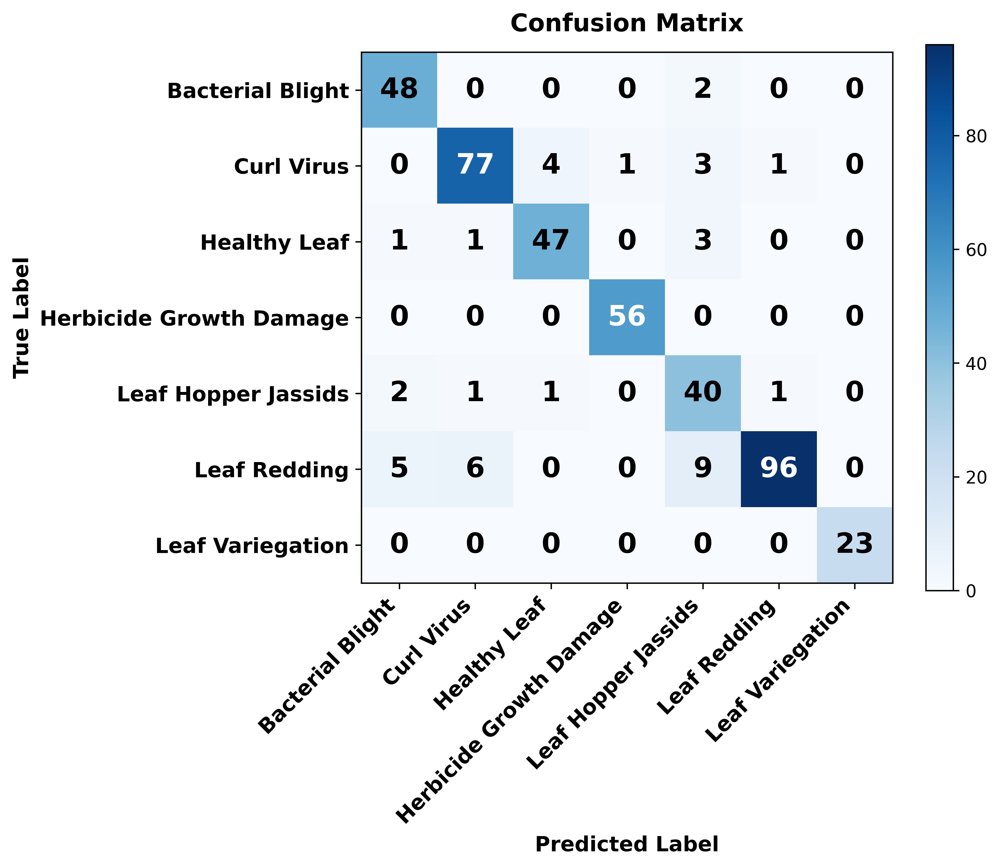
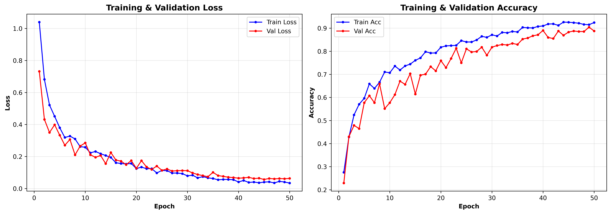

# LDASN: A Lightweight Dual-Attention Selective Network for Cotton Leaf Disease Classification
 
[](#overview)
[](#dataset)
[](#getting-started)
 
> **Dataset:** *SAR-CLD-2024: A Comprehensive Dataset for Cotton Leaf Disease Detection* (Bishshash et al., 2024)
> **Full technical documentation:** [DOCUMENTATION.md](DOCUMENTATION.md)
 
## Overview
 
This repository contains the implementation, trained weights and experimental results of **LDASN (Lightweight Dual-Attention Selective Network)**, a hybrid convolutional–Transformer architecture for classifying cotton leaf images into seven categories: six disease, pest or stress conditions and healthy leaves. The model is trained and evaluated on the 2,137 original images of **SAR-CLD-2024: A Comprehensive Dataset for Cotton Leaf Disease Detection**.
 
LDASN combines (i) a multi-scale depthwise-separable convolutional extractor with squeeze-and-excitation channel attention, (ii) a saliency-based patch selector that converts feature maps into tokens, and (iii) a four-layer Transformer encoder whose attention output is modulated by a scalar saliency gate. Class imbalance is handled with a weighted sampler and a class-weighted focal loss.
 
<p align="center">
  

</p>
<p align="center"><em>Figure 1. Overall architecture of LDASN (10,552,721 trainable parameters).</em></p>
## Main results
 
Results on SAR-CLD-2024 (7 classes, 2,137 images). All figures are produced by `main.ipynb`; further detail and caveats are given in [DOCUMENTATION.md](DOCUMENTATION.md#5-results).
 
| Evaluation protocol | Accuracy | Macro F1 |
|---|---:|---:|
| Stratified 80/20 hold-out split (428 validation images) | **90.42 %** | 0.912 |
| Stratified 5-fold cross-validation | **87.97 % ± 0.84 %** | 0.888 |
 
Additional hold-out metrics: balanced accuracy 0.925, Matthews correlation coefficient 0.887, Cohen's κ 0.885, mean specificity 0.984, macro-averaged ROC AUC 0.990 and macro-averaged average precision 0.953. The model has 10.55 M parameters and requires 3.23 ms per image on a GPU (batch size 1).
 
**Per-class results (hold-out split).**
 
| Class | Precision | Recall | F1 |
|---|---:|---:|---:|
| Bacterial Blight | 0.857 | 0.960 | 0.906 |
| Curl Virus | 0.906 | 0.895 | 0.901 |
| Healthy Leaf | 0.904 | 0.904 | 0.904 |
| Herbicide Growth Damage | 0.983 | 1.000 | 0.991 |
| Leaf Hopper Jassids | 0.702 | 0.889 | 0.784 |
| Leaf Redding | 0.980 | 0.828 | 0.897 |
| Leaf Variegation | 1.000 | 1.000 | 1.000 |
 
The principal source of error is the confusion of *Leaf Redding* with *Leaf Hopper Jassids*, *Curl Virus* and *Bacterial Blight*.
 
<p align="center">
  
  
</p>
<p align="center"><em>Figure 2. Confusion matrix (left) and training curves (right) for the hold-out experiment.</em></p>
Further figures (ROC and precision–recall curves, calibration curves, per-fold confusion matrices) are located in [`results/`](results/).
 
> **Interpretation note.** The best epoch is selected on the same validation data that is used for reporting, and no independent test set exists. The reported accuracies are therefore slightly optimistic, and the cross-validation mean is the more conservative estimate. See [Limitations](#limitations).
 
## Dataset
 
The images in [`dataset/`](dataset/) belong to **SAR-CLD-2024: A Comprehensive Dataset for Cotton Leaf Disease Detection**, collected at the National Cotton Research Institute, Gazipur, Bangladesh, between October 2023 and January 2024. Only the 2,137 original images (JPEG, 800 × 800 pixels) are used; augmentation is performed online during training.
 
| Index | Class | Images |
|---:|---|---:|
| 0 | Bacterial Blight | 250 |
| 1 | Curl Virus | 431 |
| 2 | Healthy Leaf | 257 |
| 3 | Herbicide Growth Damage | 280 |
| 4 | Leaf Hopper Jassids | 225 |
| 5 | Leaf Redding | 578 |
| 6 | Leaf Variegation | 116 |
| | **Total** | **2,137** |
 
The licence terms of SAR-CLD-2024 are given on its Mendeley Data page and apply to the images. Please cite the original authors:
 
> Bishshash, P., Nirob, A. S., Shikder, M. H., Sarower, A. H., Bhuiyan, T., and Noori, S. R. H. (2024). A comprehensive cotton leaf disease dataset for enhanced detection and classification. *Data in Brief*. [doi:10.1016/j.dib.2024.110913](https://doi.org/10.1016/j.dib.2024.110913)
>
> *SAR-CLD-2024: A Comprehensive Dataset for Cotton Leaf Disease Detection*. Mendeley Data, Version 2. [doi:10.17632/b3jy2p6k8w.2](https://doi.org/10.17632/b3jy2p6k8w.2)
 
## Method in brief
 
| Stage | Description | Parameters |
|---|---|---:|
| 1. Multi-scale extractor | Stem convolution; parallel 3 × 3 and 5 × 5 depthwise-separable branches; SE channel attention; 1 × 1 projection | ≈ 40 K |
| 2. Sparse patch selector | 1 × 1 saliency head; 16 × 16 patch scoring; top-*K* selection; linear token embedding (32,768 → 256); learned positional embedding | ≈ 8.40 M |
| 3. Transformer encoder | [CLS] token; four pre-norm blocks (4 heads, width 256, MLP 512); scalar attention gate | ≈ 2.11 M |
| 4. Classification head | Linear layer (256 → 7) with learnable temperature | ≈ 1.8 K |
 
**Training configuration.** Input 224 × 224; augmentation by flips, rotation (±20°) and colour jitter; AdamW (learning rate 3 × 10⁻⁴, weight decay 10⁻⁴); cosine-annealing schedule; batch size 16; at most 50 epochs with early stopping (patience 10); weighted random sampling; focal loss (γ = 2) with inverse-frequency class weights; seed 42.
 
Detailed diagrams of each stage are provided in [DOCUMENTATION.md](DOCUMENTATION.md#3-proposed-method-ldasn).
 
## Repository structure
 
```
.
├── main.ipynb          # complete pipeline: model, training, evaluation, figures, 5-fold CV
├── dataset/            # SAR-CLD-2024 images, one folder per class (7 classes)
├── results/            # result figures and trained checkpoints
│   ├── best_model.pt   #   hold-out model
│   └── best_fold*.pt   #   cross-validation models
├── docs/figures/       # architecture diagrams and summary charts
├── DOCUMENTATION.md    # detailed technical documentation
└── README.md
```
 
## Getting started
 
### Installation
 
```bash
pip install torch torchvision numpy pandas matplotlib seaborn scikit-learn pillow tqdm
pip install fvcore grad-cam     # optional: FLOP counting and Grad-CAM
```
 
A CUDA-capable GPU is recommended for training.
 
### Training and evaluation
 
Open `main.ipynb` from the repository root and execute the code cell. The notebook trains the model, prints all metrics, saves figures and checkpoints to `results/`, and then performs five-fold cross-validation. Hyperparameters are defined in the `CFG` dictionary at the top of the notebook.
 
> The notebook ends with `if __name__ == '__main__': main()`, which is true under Jupyter; executing the cell therefore starts training immediately.
 
### Inference
 
```python
import json, torch
from PIL import Image
 
src = ''.join(json.load(open('main.ipynb'))['cells'][0]['source'])
ns = {'__name__': 'ldasn'}                    # prevents main() from running
exec(compile(src, 'main.ipynb', 'exec'), ns)
 
CLASSES = ['Bacterial Blight', 'Curl Virus', 'Healthy Leaf', 'Herbicide Growth Damage',
           'Leaf Hopper Jassids', 'Leaf Redding', 'Leaf Variegation']
 
model = ns['LDASN'](num_classes=7)
model.load_state_dict(torch.load('results/best_model.pt', map_location='cpu'))
model.eval()
 
tf = ns['get_transforms'](train=False)
x = tf(Image.open('path/to/leaf.jpg').convert('RGB')).unsqueeze(0)
with torch.no_grad():
    probs = torch.softmax(model(x), dim=1)[0]
print(CLASSES[probs.argmax()], f'{probs.max():.2%}')
```
 
## Limitations
 
1. Model selection and reporting use the same validation data; no independent test set is available.
2. With the present setting (`top_k_patches = 50`, 49 available patches) the selection step retains every patch and therefore does not sparsify the token sequence.
3. About 80 % of the parameters are contained in the patch-projection layer.
4. Predicted probabilities are under-confident (expected calibration error 0.127), and the learned temperature does not correct this.
5. No ablation studies or baseline comparisons are included, so the contribution of individual components has not been quantified.
6. Grad-CAM explanations were not generated, because the optional package was absent when the stored run was executed.
7. SAR-CLD-2024 was collected at a single site with a single camera; generalisation to other conditions has not been evaluated.
A complete discussion and proposed future work are provided in [DOCUMENTATION.md](DOCUMENTATION.md#7-limitations-and-threats-to-validity).
 
## Citation
 
If this work is useful in your research, please cite this repository and the SAR-CLD-2024 dataset paper listed above. A suggested repository citation (please adjust the author list as appropriate):
 
```bibtex
@misc{ldasn_cotton_2026,
  title        = {LDASN: A Lightweight Dual-Attention Selective Network for Cotton Leaf Disease Classification on SAR-CLD-2024},
  author       = {Shabir, Khadijah},
  year         = {2026},
  howpublished = {\url{https://github.com/khadijah-Shabir/Cotton-Leaf-Disease-Detection-using-a-novel-architecture-}}
}
```
 
## Licence
 
No licence file is currently included in this repository; one should be added before the code is reused. The images remain subject to the licence of SAR-CLD-2024 on Mendeley Data.
 
## Acknowledgements
 
The authors of SAR-CLD-2024 (Bishshash et al.) are gratefully acknowledged for making the data publicly available. The implementation uses PyTorch, torchvision and scikit-learn.
 
